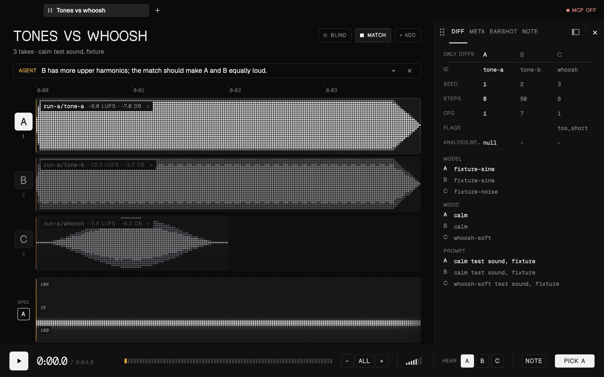
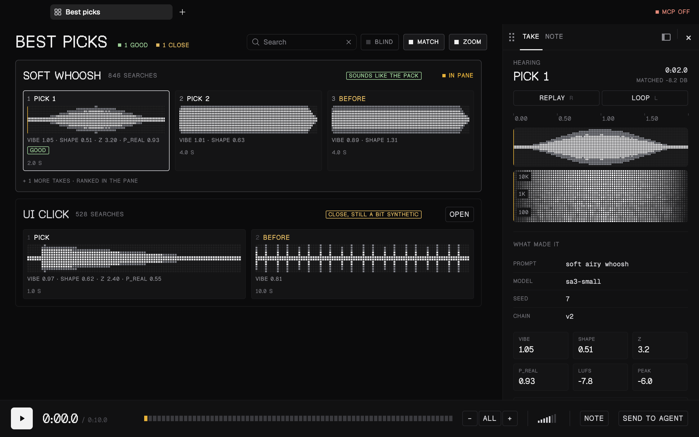
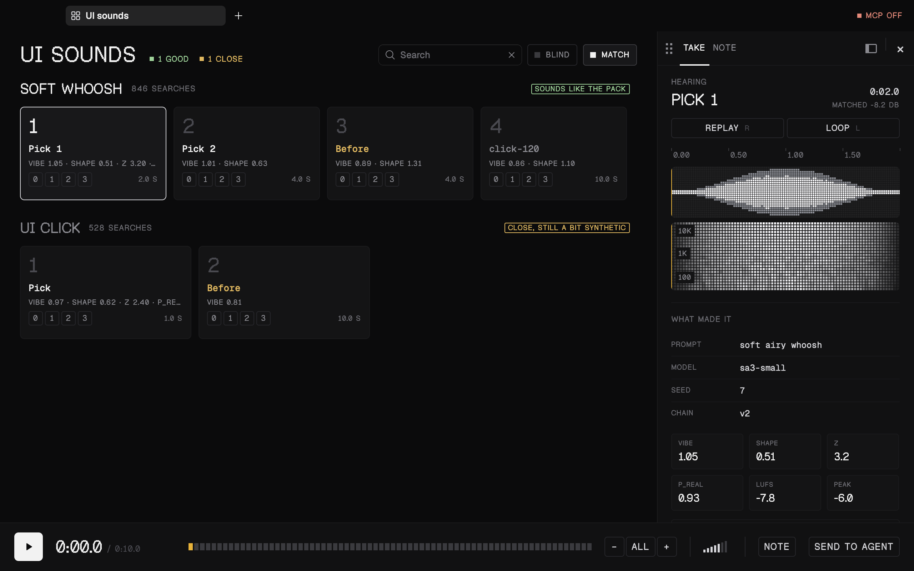
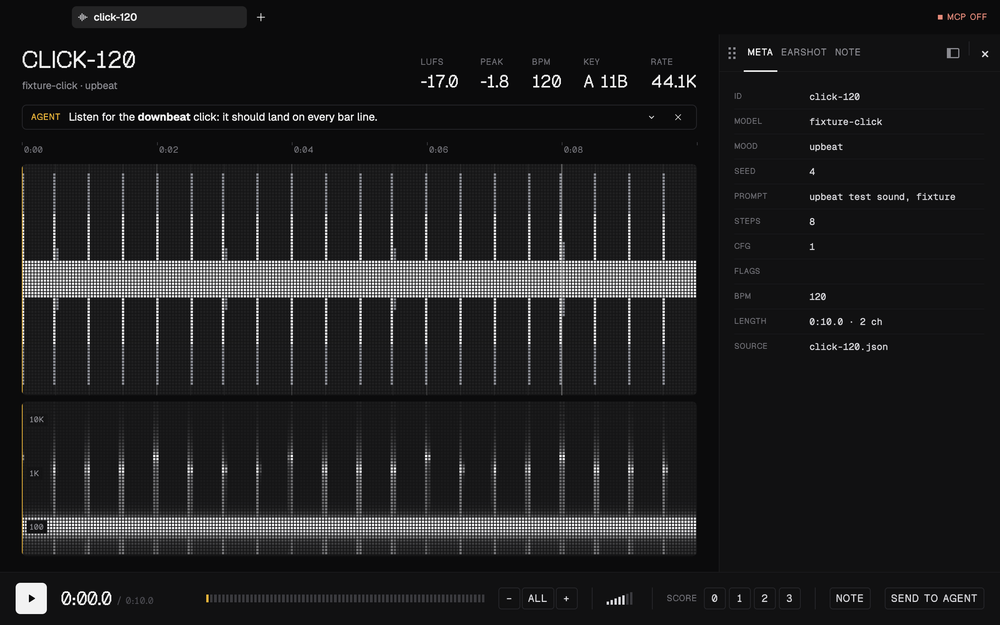
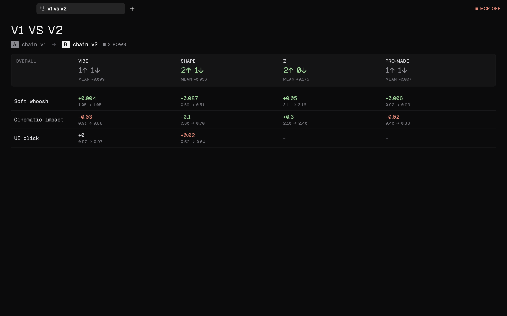

<div align="center">

# adeck

**A listening bench for generated audio, driven by your coding agent.**

Your agent opens sounds on your Mac over [MCP](https://modelcontextprotocol.io). You listen, score and pick.<br>
It reads your verdicts back and generates the next round.

[](LICENSE)




</div>

## Why

Judging generated audio means listening, and listening means comparing: the new take against the old one, against a reference, blind, at the same loudness. Building a web page for every round is slow, and some audio (a licensed reference pack) can't go on a page at all. adeck is a native player your agent drives directly. It opens exactly what you should hear, you answer with a key press, and the agent gets your answer as data.

## Features

- **Gapless A/B/N compare.** Up to nine takes on one timeline. Switching is instant and keeps the position.
- **Loudness matched by default**, so the louder take doesn't win by being louder.
- **Blind mode.** Names hide as X, Y, Z until you pick, and the pick records which was which.
- **Waveform, spectrogram and metadata** for every file, with only the differences shown in a compare.
- **Boards and pads** for reviewing many groups of sounds at once, with keep / drop / move-to on each file.
- **Stems**: split a track into drums, bass, other and vocals (Demucs, on your Mac, once per track), then solo, mute and A/B them against the mix in lanes under the tile, with each track's low-end share on its tile.
- **Runs and diffs**: browse a whole generation run as a table, or compare run A against run B per metric.
- **Selections and loops**: shift-drag a stretch, Space plays just that, L loops it.
- **Verdicts on disk**: every score, pick and note is a JSON line the agent can read or wait on.
- **Local or S3**: files from disk, from S3 through your own AWS profile, or from a reference pack that never leaves the machine.
- **Share a tab** as a web page when someone without adeck needs to listen.

<table>
  <tr>
    <td width="50%"><br><sub><b>Board</b>: groups of takes, keep / drop / move each</sub></td>
    <td width="50%"><br><sub><b>Pads</b>: one-shot effects, played like a sampler</sub></td>
  </tr>
  <tr>
    <td width="50%"><br><sub><b>One file</b>: waveform, spectrogram, metadata, score 0–3</sub></td>
    <td width="50%"><br><sub><b>Diff</b>: run A against run B, per group and metric</sub></td>
  </tr>
</table>

## Quick start

adeck runs on macOS (it plays through CoreAudio and AVFoundation). You need [Rust](https://rustup.rs); the right toolchain installs itself.

```sh
git clone https://github.com/soumyadip-clueso/adeck
cd adeck
cargo run --release
```

To keep it as an app, install [just](https://github.com/casey/just) and run `just install`. It builds `~/Applications/adeck.app` and updates it in place when you run it again.

Then connect your agent. adeck serves MCP on `http://127.0.0.1:7717/mcp` while it's open:

```sh
claude mcp add --transport http adeck http://127.0.0.1:7717/mcp
```

or in a project's `.mcp.json`:

```json
{ "mcpServers": { "adeck": { "type": "http", "url": "http://127.0.0.1:7717/mcp" } } }
```

Now ask your agent to *"open these three takes blind"* or *"show me the run and wait for my scores"*.

## How it works

1. The agent opens a tab (`open_compare`, `open_board`, …) and pins a note on what to listen for.
2. You listen and answer: 0–3 to score, Enter to pick, K / D to keep or drop.
3. The agent reads your answer (`wait_for_feedback` blocks until you give one) and opens the next round.

Every view, control and shortcut is in **[docs/usage.md](docs/usage.md)**. Press `?` in the app for the keys.

## MCP tools

| Tool | What it does |
|---|---|
| `list_runs`, `list_items`, `get_item` | Find runs and items; everything known about one item |
| `open_single`, `open_compare`, `open_render`, `open_run` | Open a file, a compare, renders or a run; each returns a `tab_id` |
| `open_board`, `board_upsert` | A board of groups; add or replace groups while it's open |
| `open_pads` | Sound pads for one-shot effects |
| `open_diff` | Run A against run B, per group and metric |
| `list_tabs`, `focus_tab`, `close_tab` | Manage tabs |
| `annotate_tab` | Pin a note on what to listen for |
| `play`, `stop`, `set_loop` | Play a tab, a group or a take from a time (or its stems, soloed); pause; loop a region |
| `split_stems` | Split a tab's tracks into stems in the background, once each |
| `screenshot_tab` | A PNG of a tab as the user sees it |
| `get_feedback`, `wait_for_feedback` | Scores, picks and notes; wait for the next one |
| `get_decisions` | The latest keep / drop / move on each file of a board |
| `get_selection` | What the user pointed you at: the tab, take, selection or loop, and the playhead |
| `analyze` | Run [earshot](#configuration) `describe`, `measure`, `critique` or `timeline` on a file (cached) |
| `share_tab`, `list_shares`, `open_shared`, `unshare` | Publish a tab as a web page; list, open or take down shared pages |

Item ids are absolute paths, `run:<run>/<path>`, `ref:<path>` (the reference pack) or `s3://` URLs. Replies are compact JSON, so the tools stay cheap in an agent's context.

## Configuration

Everything is optional. Without a config adeck opens any path it's given. To add runs, a reference pack or S3, write `~/.config/adeck/config.toml`:

```toml
port = 7717
run_roots = ["~/work/generations"]   # folders whose sub-folders of audio are runs
refs_dir = "~/work/refs"             # a reference pack: badged REF, never uploaded
earshot = "earshot"                  # optional analysis CLI, for describe / measure / critique

[s3]                                 # runs in S3, read through the aws CLI
profile = "my-profile"
bucket = "my-bucket"
prefix = "audio/runs"
region = "us-west-2"
expired_hint = "run `aws sso login --profile my-profile`"
```

Metadata is found, not configured. A `<name>.json` beside a file wins. Otherwise adeck looks in the JSON files of the file's folder and the one above for an object that names the file. Sharing has its own section; see [docs/usage.md](docs/usage.md#screenshots-and-sharing). Caches live in `~/Library/Caches/adeck`.

## Development

```sh
just            # list every recipe
just hot        # run with live editing: UI changes patch into the open window
just check      # clippy on every save
just test       # tests, then every headless scene into target/snaps/
just screenshots
```

`just hot` uses [Rune](https://github.com/anomalyco/rune)'s hot patching and needs Dioxus CLI 0.7.10 (`cargo install dioxus-cli@0.7.10 --locked`). A changed function body in `src/ui/` or `src/app.rs` patches into the window in about a second and keeps your tabs; anything else rebuilds and relaunches.

Every screen renders headless from fixture audio adeck generates itself: `adeck --snap out.png --scene compare` (scenes: `single compare blind run board pads diff shared activity palette keys empty`). The screenshots above come from `just screenshots`.

Rune is pinned to one commit. `just bump-rune` moves it to the latest and runs the lints, tests and scenes.

## Credits

adeck is a fork of [Sleeve](https://github.com/alii/sleeve) by Alistair Smith, with its rekordbox and USB export removed. It's built on [Rune](https://github.com/anomalyco/rune), [symphonia](https://github.com/pdeljanov/Symphonia), [cpal](https://github.com/RustAudio/cpal) and [rbxport](https://github.com/chrisle/rbxport)'s analyser, and set in [Geist, Geist Mono and Geist Pixel](https://github.com/vercel/geist-font) (SIL Open Font License 1.1, in `assets/fonts/`).

## License

[GPL-2.0-or-later](LICENSE), as Sleeve.
