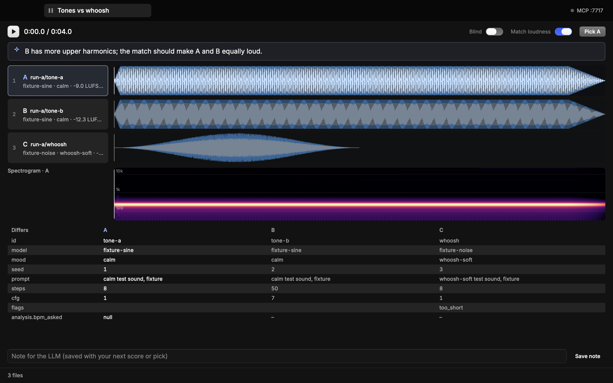

# adeck

A listening bench for generated audio, driven by your coding agent. The agent opens tabs on your Mac over MCP: one file, an A/B/N compare, a render, or a whole run. You listen, score, pick and write notes. The agent reads your verdicts back and keeps going.



Forked from [Sleeve](https://github.com/alii/sleeve), a rekordbox app by Alistair Smith. The rekordbox and USB parts are gone. Sleeve's look, its job system and its Rune UI stay.

## What a tab shows

Every tab has the same frame: the page in the middle, the **player** along the bottom (play, the clock, an LED overview to scrub, zoom, volume, then score keys, the take you hear, Pick and Send to agent), and one **pane** beside the page with everything about the sound that isn't the sound itself: metadata, the diff, earshot, the target, and your note. The pane docks left or right (the buttons in its head) or hides to a thin tab on the edge; `\` hides and brings it back, and dragging its grip resizes it.

- **One file**: the waveform with its beat grid, a spectrogram, every metadata field found for it, loudness, peak, tempo and key, and earshot's description and measurements. Keys 0 to 3 score it.
- **A compare (2 to 9 files)**: every waveform on one time axis with one playhead. They all play at once and you hear one; keys 1 to 9 switch at exactly the same moment, with no gap. Loudness matching (on by default) brings each file to the same LUFS, so the louder one doesn't win by being louder. Blind mode hides the names as X, Y, Z until you pick. The pane's DIFF shows only the metadata that differs. Enter picks the one you're hearing.
- **A render**: the video, earshot's scorecard and fixes, and every picture cut marked by whether it got a hit, some sound, or silence. Several renders switch like a compare.
- **A run**: every item as a sortable table. Filter by any text, show what you haven't scored, open one or compare a selection.
- **A board**: one card per group (a category, say), sorted by whatever the agent says matters (search count, say), each a row of tiles: the picks, the raw "before", the reference files, with the agent's numbers and a verdict chip, and a tally on top. Click a tile to play it; only one plays, and switching inside a group keeps the position, loudness-matched. The group in focus opens in the pane's TARGET: waveform and spectrogram zoomed to the sound (a 60 ms click fills the strip), bands, stereo width, tail and attack against the group's target, what made the file (prompt, model, seed, chain, a copyable path), keep / drop / move-to, and the ranked rest of the takes, folded. Blind hides who's who in each group as X, Y, Z until you pick. The agent adds or replaces groups while it's open.
- **Pads**: for one-shot effects. Each file is a big button: click it, or press its key (1 to 0, then Q to P), and it plays from the top, cutting off whatever was playing, with a bar filling as it plays. Score it 0 to 3 on the pad (or Z X C V for the one you just played), keep or drop it. Its strips and target sit in the pane; hide the pane (`\`) for pads alone. The agent opens pads with `open_pads` (a list of files, or groups) or a board with `layout: "pads"`.
- **A diff**: run A against run B, one row per group, one column per metric, the change coloured by which way is better, with how many got better and worse. A row that names a file from each side opens them as a compare.

Press or drag on a waveform to scrub; drag along the time ruler above it to loop a stretch (click the ruler to clear it). − and + zoom the time axis around the playhead (= and − on the keyboard, F fits the file or the loop, [ and ] pan), and a zoomed view follows the playhead as it plays. The strips fill the window. The player has a scrubber over the whole file and a volume. Space plays, ← and → step a second (with ⇧, five), Esc clears the loop, `\` hides or shows the pane, ⌘W closes the tab. ⌘K searches commands, tabs, groups, sounds, runs and shared pages; / searches the tab you're on; ? lists every key. Tabs come back when you reopen adeck.

**+** after the tabs (⌘T) opens a file (⌘O), a folder (as a table), a new empty compare, or a run. Drop files on a single file or a compare and they join it side by side; × takes one off. N opens your note for the agent in the pane; the agent's own note folds or dismisses.

**Send to agent**: double-click a strip, a tile or a compare member (or press S) and adeck hands the agent what you're on (the tab, group, member, the loop or zoomed stretch, the playhead and your note) through `get_selection`, and copies a line to paste into the chat.

On a board: ↑ ↓ change group, ← → play the previous or next tile (⇧ seeks five seconds), 1 to 9 play a tile, R replays from the start of the sound, L loops what the strip shows, Z zooms to the sound or the whole file, K keeps, D drops, B goes blind, M toggles the loudness match, Enter picks.

## Verdicts

Every score, pick, note and keep/drop/move decision is one JSON line in `~/.config/adeck/feedback.jsonl`. When all the items sit in one local run, the line also goes into that run's own `feedback.jsonl`. A blind pick records which label was which. The agent reads them with `get_feedback`, or waits for the next one with `wait_for_feedback`.

## Get it

macOS only (the audio and video run on AVFoundation and CoreAudio). You need Rust; the right toolchain installs itself from `rust-toolchain.toml`.

```sh
git clone https://github.com/soumyadip-clueso/adeck
cd adeck
cargo run --release
```

The first build takes a few minutes. To keep it as an app, `just install` builds a release and installs `~/Applications/adeck.app` (run it again to update in place); `just clean-dev` frees the debug build afterwards.

## Connect your agent

adeck serves MCP on `http://127.0.0.1:7717/mcp` while it's open.

```sh
claude mcp add --transport http adeck http://127.0.0.1:7717/mcp
```

Or in a project's `.mcp.json`:

```json
{ "mcpServers": { "adeck": { "type": "http", "url": "http://127.0.0.1:7717/mcp" } } }
```

| Tool | What it does |
|---|---|
| `list_runs`, `list_items`, `get_item` | Find runs and items; everything known about one item |
| `open_single`, `open_compare`, `open_render`, `open_run` | Open a tab; each returns its `tab_id` |
| `list_tabs`, `focus_tab`, `close_tab`, `annotate_tab` | Manage tabs (`list_tabs` is one line per tab; give a `tab_id` for its members); pin markdown on what to listen for |
| `play`, `stop`, `set_loop` | Playback |
| `screenshot_tab` | A PNG of a tab as you see it |
| `get_feedback`, `wait_for_feedback` | Your verdicts |
| `analyze` | Run earshot `describe`, `measure`, `critique` or `timeline` (cached) |
| `open_board`, `board_upsert` | A board of groups; add or replace groups (or a diff's rows) while it's open |
| `open_pads` | Sound pads for one-shot effects |
| `open_diff` | Run A against run B, per group and metric |
| `get_decisions` | Your latest keep / drop / move on each file of a board |
| `get_selection` | What you pointed the agent at, newest first |

Replies are compact JSON with nulls left out, and shared shapes (board groups, diff rows) are spelled out once, so the tools stay cheap in an agent's context. Item ids are absolute paths, `run:<run>/<path>`, `ref:<path>` (the reference pack) or `s3://` URLs.

## Screenshots and sharing

- **Screenshot** (camera in the footer, ⌘⇧S, or `screenshot_tab pretty: true`): the tab at 2x, framed on a
  gradient with rounded corners and a shadow, saved to `~/Pictures/adeck` and copied to the clipboard.
- **Share** (share icon in the footer, ⌘⇧E, or `share_tab`): the tab becomes a web page with gapless A/B
  players, waveforms, numbers and details. The link is copied. Reference-pack audio never leaves your
  machine: those members show as local-only, under the name "Reference".
- **Shared pages** (+ menu, or `open_shared` / `list_shares`): every page you've shared, with Open, Copy
  link and Take down. Taking a page down deletes it and its audio (`unshare`). A page taken down
  somewhere else shows as taken down, and its S3 audio is cleared.

Sharing calls a publisher program you name in the config, so any host works:

```toml
[share]
command = "~/.config/adeck/my-publisher"   # publish <dir> <slug> <title> → {"url": …}; remove <slug>; list → [{slug, url}]
prefix = "adeck-"
audio = "bundle"                           # audio inside the page, or "s3":
# [share.s3]
# bucket = "…"; prefix = "shares"; profile = "…"; region = "…"; public_url = "https://…"
```

## Config

`~/.config/adeck/config.toml`. Everything is optional; without it adeck opens any path it's given.

```toml
port = 7717
# Folders whose sub-folders of audio are runs, named by their path under the root.
run_roots = ["~/work/generations"]
# A reference pack that stays on this machine: shown with a REF badge, never sent anywhere.
refs_dir = "~/work/refs"
earshot = "earshot"   # the earshot CLI, for describe/measure/critique/sheet
aws = "aws"

# Runs in S3, read through the aws CLI with your own profile.
[s3]
profile = "my-profile"
bucket = "my-bucket"
prefix = "audio/runs"
region = "us-west-2"
expired_hint = "run `aws sso login --profile my-profile`"
```

Metadata is found, not configured: a `<name>.json` beside a file wins. Otherwise adeck looks in the JSON files of the file's folder and the one above for an object that names the file, and takes that object and the fields around it.

Caches (analysis, spectrograms, earshot output, S3 downloads) live in `~/Library/Caches/adeck`.

## Develop

```sh
just          # lists everything
just hot      # the app with live editing: UI edits patch into the open window
just check    # clippy on every save (bacon)
just test     # unit and UI tests, then every headless scene into target/snaps/
just snap compare
```

`just hot` uses Rune's own live editing (Dioxus's subsecond hot patching). It needs Dioxus CLI 0.7.10 (`cargo install dioxus-cli@0.7.10 --locked`; Homebrew's `dx` is a different program). A changed function body in `src/ui/` or `src/app.rs` patches into the open window in about a second and keeps the open tabs. Any other change rebuilds and relaunches, and the tabs come back. `just hot --snap-on-patch target/hot.png` renders headless and writes a PNG after every patch, for an agent checking its own UI edits.

Every headless scene renders from fixture audio adeck writes itself: `adeck --snap out.png --scene single|compare|blind|run|board|pads|empty`.

Rune is pinned to one commit in `Cargo.toml` (`rune`, `rune-kit` and `rune-theme-opencode` share it), so its changes reach adeck only when you move the pin. `just bump-rune` moves all three to the tip of Rune's default branch (or `just bump-rune <sha>`), updates the lockfile, then runs clippy, the tests and every scene; look over `target/snaps/` and commit `Cargo.toml` and `Cargo.lock`.

## Licence

GPL-2.0-or-later, as Sleeve. Built with [Rune](https://github.com/anomalyco/rune), [rbxport](https://github.com/chrisle/rbxport)'s analyser, symphonia and cpal. Set in [Geist, Geist Mono and Geist Pixel](https://github.com/vercel/geist-font) (SIL Open Font License 1.1, in `assets/fonts/`).
